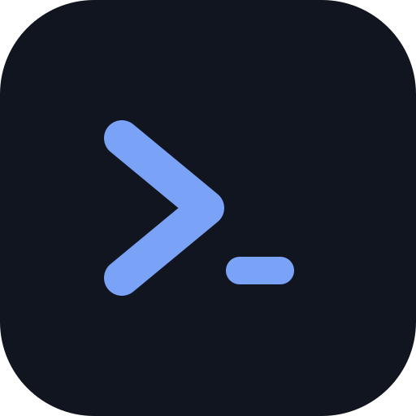
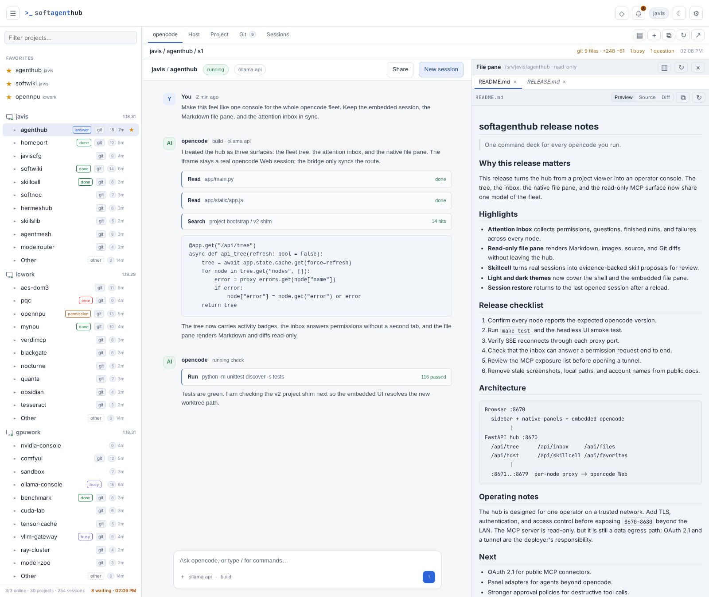
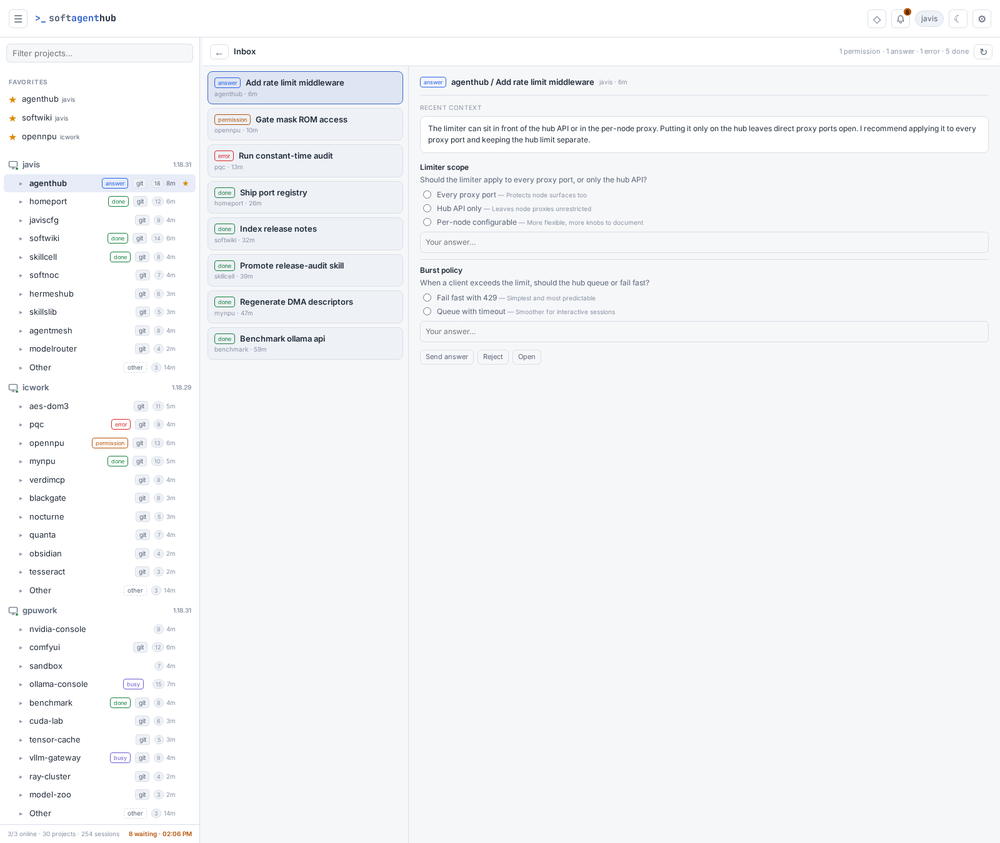
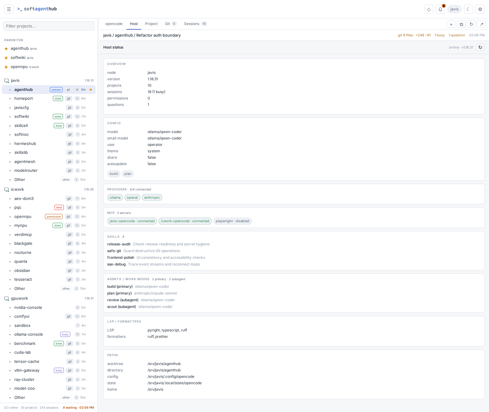
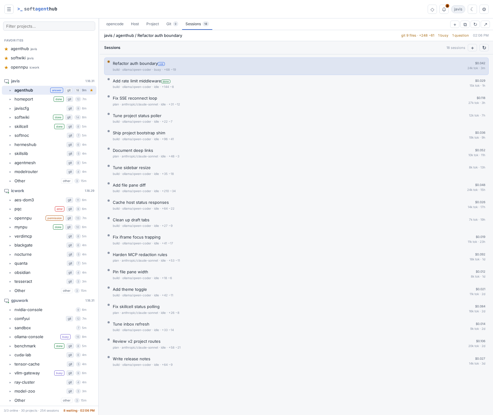
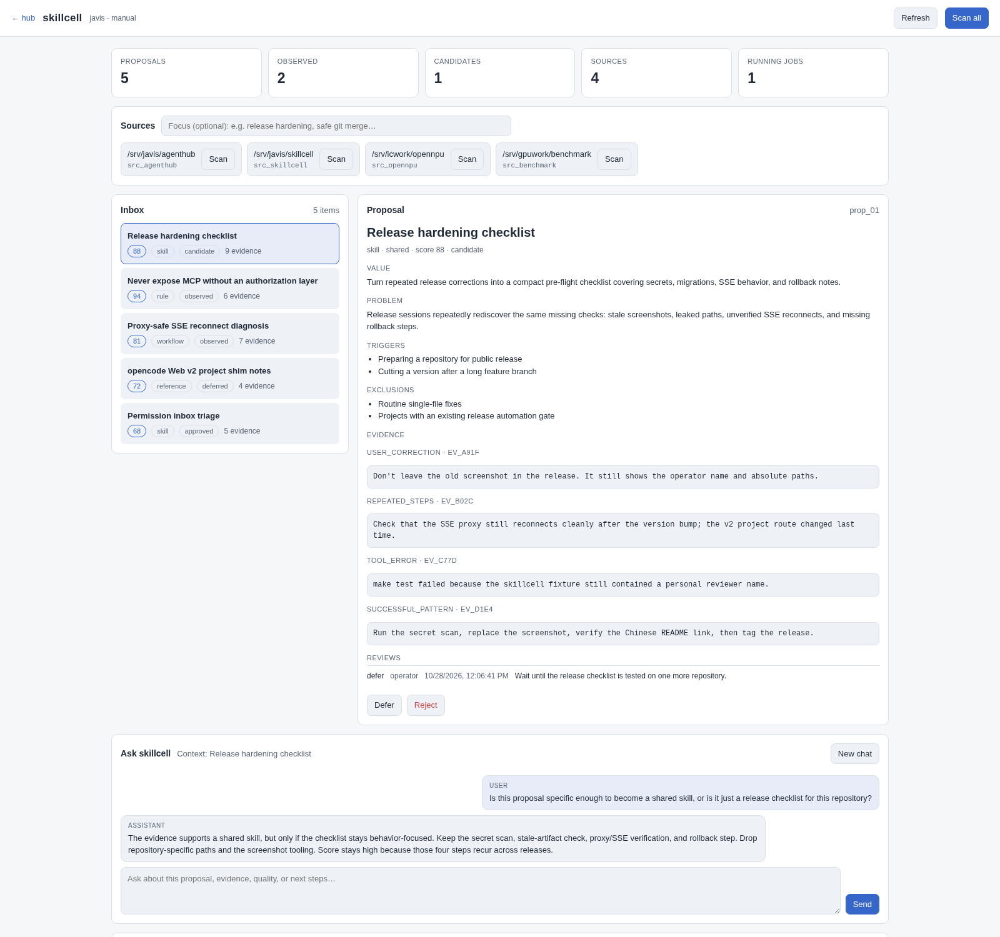

<p align="center"></p>

<h1 align="center">softagenthub</h1>

<p align="center"><strong>给所有 opencode，一个统一指挥台。</strong><br>
一个单操作者视角的 Web 驾驶舱，把散落在多台机器上的 opencode 收拢成一张清晰、可控的工作面。</p>

[English](README.md) · 简体中文 · [设计笔记](docs/pr.md) · [安全边界](docs/security.md)



<p align="center"><sub>演示舰队与示例数据；嵌入区域为 opencode 会话示意。</sub></p>

> 对外名称是 **softagenthub**。内部服务名、配置路径和 SQLite 数据库仍使用更短的 `agenthub` 标识。

## 先说结论

opencode 已经是一个很强的本地执行者。它缺的是“从高处看”的能力：很多机器、很多项目、很多会话，却没有一个地方能同时看到谁在跑、谁在等、谁需要你拍板。

softagenthub 就是那个地方。

它不替代 opencode，不把 opencode 塞进一套私有的工作流，也不假装网络环境天然安全。它聚合节点、嵌入真正的 opencode Web UI、增加一层原生检查能力，并对外提供一个刻意收窄的只读 MCP 接口，让其他 agent 可以观察，但不能乱动。

核心理念很简单：**好的驾驶舱应该让机器更清晰，而不是把机器藏起来。**

## 它为什么不一样

- **一棵树，管所有机器。** 节点 → 项目 → 会话，带收藏、过滤、实时计数和注意力标记。
- **嵌入真正的 opencode。** 不重写编辑器，不做功能滞后的仿制品。代理在服务端注入凭据，完整透传 SSE 和 WebSocket，iframe 里的体验和本地 opencode Web UI 一致。
- **一个给人看的收件箱。** 权限请求、待回答的问题、已完成的运行、失败的任务，全舰队汇总，可以直接在 hub 里回复或继续追问。
- **需要细节时有原生面板。** Host 状态、项目状态、Git 变更、会话列表，以及带预览和 diff 的文件面板。
- **可选的技能挖掘实验室。** Skillcell 会读取真实会话、提取证据，提出可复用的 skill、rule、workflow 候选，交给你审核。它不会背着你改技能库。
- **只读 MCP 桥。** 让其他 agent 检查舰队状态，但拿不到消息正文、diff、凭据或任意路径。
- **没有前端构建链。** FastAPI + 原生 JavaScript。能读、能改、能 fork。

## 典型场景

### 1. 多项目、多平台、远程集中操作

一台 Linux 工作站、一台 Mac mini、一台 GPU 机器、一台 VPS，各自跑着 opencode。过去要开四个浏览器标签、记四套密码；现在只开一个 hub：所有项目都在左侧树里，所有会话一点即达，所有待处理的权限都在同一个收件箱。

这是最核心的用法。hub 是操作者的驾驶舱，不是任务调度器。

### 2. 接入其他 agent 代管，比如 ChatGPT 语音助理

把 ChatGPT 之类的外部助手当成“前台”：问它现在在跑什么、哪个项目卡住了、昨晚哪些会话完成了。通过只读 MCP，它可以查询主机、项目、会话、Git 统计和待处理事项；真正的决定仍然在 softagenthub 里由你做。

写入路径是故意不开放的。远程 agent 可以观察，但不能通过 MCP 批准权限、修改文件或执行命令。这条边界本身就是设计的一部分。

### 3. 长时间任务的统一分诊

多个 agent 连续跑几个小时。softagenthub 让整个舰队保持可见：忙碌会话、已完成任务、失败、待回答问题、Git 漂移。收件箱把“现在到底什么需要我？”压缩成一张短列表，而不是一场标签页寻宝。

## 先泼一盆冷水：这是给愿意折腾的人用的

softagenthub 是一件打磨过的工具，不是一个托管服务。它默认你会读配置、会配反向代理，也默认你愿意为自己的网络环境负责。

- **局域网 / 单操作者 / 可信用户。** 没有登录层，没有 RBAC，没有多租户隔离。Settings 写入 API 没有认证，能访问 hub 的人就能改主机配置。
- **不要直接暴露到公网。** `8670–8680` 不是公网服务。HTTPS、认证、访问控制、防火墙，都要你自己补。
- **opencode 迭代很快。** 深链接、iframe 行为和 Web v2 兼容层都针对近期版本验证过，但升级可能打破假设。每次升级后请重新测试。
- **这个壳是有观点的。** 它围绕 opencode 会话和单用户工作流设计。其他 agent 通过适配器或 MCP 接入，不通过插件市场。
- **风险半径由你负责。** hub 代理凭据并嵌入一个能执行工具的前端。能访问 hub，基本等同于能访问每台节点的项目、文件和命令执行能力。

如果你想要一个有账号、有配额、有支持合同的 SaaS，这不是。如果你想要一个真正贴合自己舰队的驾驶舱，继续往下看。

## MCP：能力给你，安全别指望它替你兜底

内置的 `sah-mcp` 刻意做得很保守：

- **只读**，只发 GET 请求。
- 工具参数不能带任意 URL 或文件路径；项目目录必须匹配已暴露的项目。
- 返回前会清除绝对 home/state/config 路径、技能位置、LSP 根目录和分享链接。
- 不会返回消息正文、diff、token 或凭据。
- 支持 bearer 认证、Host/Origin 检查、限流和请求审计。

但这是一条起跑线，不是终点线。

**MCP 的安全问题必须由你根据自己的环境解决。** 如果你要让 ChatGPT 或其他公网客户端访问，就要自己补上互联网级防护：OAuth 2.1 和授权页面、TLS 隧道、token 轮换、严格的 Host/Origin 策略、审计留存和网络隔离。当前的 bearer-only 端点适合局域网，或带有额外控制的私有隧道；不适合直接裸奔在公网。

在暴露任何东西之前，先读 [`docs/security.md`](docs/security.md)。

## 功能地图

| 模块 | 能力 |
| --- | --- |
| 舰队树 | 节点、项目、会话、收藏、过滤、可拖拽侧栏、布局持久化 |
| 嵌入 opencode | iframe 中的真实 Web UI、Basic Auth 注入、SSE/WebSocket 透传、深链接 |
| 兼容层 | Web v2 `/api/project` 映射、项目引导、最后会话恢复、草稿标签清理 |
| 注意力收件箱 | 权限、问题、完成、失败；内联回复和继续追问 |
| Host 面板 | 版本、模型、provider、MCP 连接、skill、agent、LSP、formatter、路径 |
| Project 面板 | worktree、会话、忙碌状态、权限、问题、Git 摘要 |
| Git 面板 | 变更文件、增删行数、单文件 diff |
| Sessions 面板 | 按项目聚合的会话索引、状态、token、成本、最后活动 |
| 文件面板 | 只读目录树、文本/图片预览、Markdown 渲染、diff、文件搜索 |
| Skillcell | 可选的“会话 → 技能”审计流水线，含证据、提案、审核和对话 |
| MCP | 主机、项目、会话、状态、Git/权限/问题计数的只读工具 |
| 运维 | 一条命令部署 systemd、热重载配置、SQLite 收藏、完整测试 |

### 注意力收件箱

收件箱是整个壳的运营核心。它会汇总：

- 需要允许/永久允许/拒绝的权限请求；
- 需要回答的问题；
- 成功完成的会话；
- 失败的会话。

你可以不离开 hub 直接回复，也可以向同一个会话继续发提示。多个 agent 并发运行时，这部分最能救命。

### 点击项目时发生什么

- 点击项目会打开它**最后一次打开的会话**，否则打开**最新会话**。
- 如果项目还没有会话，会在该项目目录下打开一个**新会话草稿**。
- 草稿标签会被复用和清理，不会每点一次就多出一个 “New session”。
- iframe 内部的导航会同步回外壳，刷新和深链接都能回到同一个会话。
- opencode 没有显式的“创建项目” API；项目来自目录和会话。`/:dir` 路由是新会话草稿，不是项目页。

### Skillcell（可选）

Skillcell 是独立的审计流水线，默认关闭。它会扫描指定节点上的近期 opencode 会话，提取证据（用户纠正、成功模式、重复步骤、工具错误、技能缺口），再让 opencode 模型提出可复用产物：skill、rule、workflow、MCP tool 或 reference。

提案保存在独立 SQLite 数据库里，并保留证据。你可以 promote、defer、reject、reopen，也可以围绕某个提案和审计模型对话。reasoner 和 chat 会话都禁用了编辑类工具。Skillcell 不会自动修改你的技能库。

证据在存储和送入模型前会脱敏，但仍会从源节点流向执行节点上的模型。请把执行节点和模型 provider 纳入你的信任边界。

建议从 `auto_scan: false`、较短的回看窗口和较小的 `max_sessions` 开始。确认输出质量后再逐步放宽。

## 界面细看

这个壳是为“扫一眼”设计的：信息足够密，但需要你处理的东西足够显眼。

**注意力收件箱。** 权限、问题、失败和已完成任务共用一个队列，不用再开新标签页。



**Host 状态。** 当前节点的版本、模型、provider、MCP 连接、技能、agent、LSP、formatter 和路径。



**Sessions。** 紧凑的会话索引，带状态、模型、agent、diff 计数、token、成本和最后活动时间。



**Skillcell。** 有证据支撑的技能提案、审核决策和审计对话，都在同一个壳里。



所有截图均使用演示舰队和示例数据。

## 快速开始

### 前提

- Python 3.10+。
- 一台或多台 opencode 节点，API 服务和 Web UI 都能通过网络访问。
- 浏览器能访问 hub 和节点代理端口。
- hub 本身不需要 Node.js 构建。只有可选的 JavaScript 语法检查会用到 Node。

### 安装

```bash
git clone <your-repository-url> softagenthub
cd softagenthub
make setup
```

### 配置

```bash
mkdir -p ~/.config/agenthub
cp config.example.yaml ~/.config/agenthub/config.yaml
chmod 600 ~/.config/agenthub/config.yaml
$EDITOR ~/.config/agenthub/config.yaml
```

密码通过环境变量引用，不要写进配置文件：

```bash
cat >> ~/.config/agenthub/env <<'EOF'
OPENCODE_SERVER_PASSWORD=change-me
EOF
chmod 600 ~/.config/agenthub/env
```

最小节点配置：

```yaml
nodes:
  - name: studio
    api_url: http://192.0.2.10:4096
    web_url: http://192.0.2.10:4097
    username: opencode
    password_env: OPENCODE_SERVER_PASSWORD

  - name: edge
    api_url: http://192.0.2.11:4096
    web_url: http://192.0.2.11:4097
    username: opencode
    password_env: OPENCODE_SERVER_PASSWORD
```

hub 默认监听 `8670`，每个节点的代理端口从 `8671` 开始。可用 `hub.proxy_base_port` 修改基准端口，用 `nodes[].proxy_port` 单独指定。

### 运行

```bash
AGENTHUB_CONF=~/.config/agenthub/config.yaml make run
```

打开 `http://<hub-host>:8670`。

### 部署为 systemd 用户服务

```bash
make deploy       # hub
make deploy-mcp   # 可选的只读 MCP
make status
make logs
```

默认同步到 `/opt/agenthub`，安装 systemd 用户单元、启用并重启服务。可用 `DEPLOY_DIR=...` 修改目标目录。

## 配置说明

```yaml
hub:
  name: studio            # 浏览器标题：sah - studio
  host: 0.0.0.0
  port: 8670
  proxy_base_port: 8671

refresh_interval_s: 20
request_timeout_s: 6
state_db: ~/.local/share/agenthub/agenthub.db
```

环境变量覆盖：

- `AGENTHUB_CONF`：配置文件路径。
- `AGENTHUB_STATE_DB`：SQLite 状态数据库。
- `AGENTHUB_PROXY=0`：关闭节点代理（测试用）。

Settings UI 会实时改写 `config.yaml`，保留 `config.yaml.bak` 备份，并热重启代理。注意：这条写入路径不会保留配置文件里的注释。

## 架构

```text
浏览器 :8670
  侧栏 + 原生面板 + 嵌入的 opencode iframe
        |
        v
FastAPI hub :8670
  ├─ /api/tree             聚合 /project、/api/session、健康状态
  ├─ /api/sessions         项目会话 + /session/status
  ├─ /api/project-status   /vcs/status + /permission + /question + status
  ├─ /api/host-status      /config + /provider + /agent + /skill + /mcp + /lsp
  ├─ /api/inbox            注意力队列 + 权限/问题回复
  ├─ /api/files/*          只读列表、预览、diff、搜索
  ├─ /api/skillcell/*      可选的审计流水线
  ├─ /api/favorites        SQLite
  ├─ /api/settings         hub 名称和主机配置
  └─ :8671..:8679          每节点代理 -> node:4097
                           Basic Auth 注入、SSE/WebSocket 透传

sah-mcp :8680
  只读 Streamable HTTP MCP、bearer 认证、脱敏、限流
```

设计要点：

- **不修改 opencode。** 只使用它的 HTTP API，并嵌入它的 Web UI。
- **每个节点一个代理端口。** 避免重写 SPA 内部的绝对路径。
- **Web v2 兼容层。** 当前 opencode Web UI 调用 v2 项目路由，代理解析并映射到 v1，再包成 `{data: ...}`。
- **项目引导。** 代理把节点项目列表和当前项目写入 opencode Web，修复 Projects 视图和文件管理器目录。
- **iframe 桥。** 注入一小段脚本，把 iframe 内部导航同步回外壳。
- **同一时间只保留一个 iframe。** 避免大量隐藏 frame 产生重复 SSE/WebSocket 连接。

## MCP 配置

```bash
echo 'AGENTHUB_MCP_TOKEN=<long-random-token>' >> ~/.config/agenthub/env
chmod 600 ~/.config/agenthub/env
make run-mcp
```

在 `config.yaml` 中加入：

```yaml
mcp:
  host: 127.0.0.1
  port: 8680
  path: /mcp
  # public_url: https://mcp.example.com
  auth:
    mode: bearer
    token_env: AGENTHUB_MCP_TOKEN
  allowed_hosts: []          # 为空时自动包含 localhost 和 public_url
  allowed_origins: []
  expose_nodes: []           # 为空 = 全部
  expose_projects: []        # 为空 = 全部；可按路径前缀限制
  max_sessions: 100
  max_projects: 200
  max_status_items: 100
  rate_limit_per_min: 60
```

工具：

- `list_hosts`
- `get_host_status`
- `list_projects`
- `list_sessions`
- `get_project_status`
- `get_session_meta`

服务只暴露 `/mcp` 和 `/healthz`。token 和 payload 不会写入日志。

## 测试

```bash
make test    # 单元 + API + 代理/SSE/WS + skillcell + JS 语法
make smoke   # headless Chrome UI 冒烟测试（需要运行中的 hub）
```

测试覆盖配置解析、Base64 深链接、项目过滤、主机/项目状态、收藏、HTTP/SSE/WebSocket 代理、v2 兼容层、HTML 桥注入、文件路径安全、收件箱逻辑和 skillcell 流水线。`make smoke` 会操作真实 UI：侧栏、拖拽、面板、iframe、最后会话恢复、新会话和桥接同步。

## 完成度与路线图

**已完成并在日常使用：**

- 多节点聚合、嵌入 opencode、深链接、Web v2 兼容层；
- 项目/会话恢复、草稿标签清理；
- 收藏、Host/Project/Git/Sessions 面板；
- 带权限和问题回复的注意力收件箱；
- 只读文件面板，含预览和 diff；
- 可选的 skillcell 审计流水线；
- 带脱敏和限流的只读 MCP；
- 单元、API、代理和 UI 冒烟测试。

**仍需折腾：**

- ChatGPT 连接器所需的 OAuth 2.1 和公网 HTTPS 隧道；
- 多用户账号和按主机授权；
- 面向非 opencode agent 的插件/面板抽象；
- 超出 opencode 自带能力的沙箱或审批策略；
- 对每一个未来 opencode 版本的持续验证。

这是一个严肃的单操作者工具，不是一个完工的多租户平台。升级和公网暴露都应当按工程问题对待。

## 目录结构

```text
app/        FastAPI hub、opencode 客户端、代理、收件箱、文件
app/mcp/    只读 MCP 服务
app/static/ 原生前端
skillcell/  审计引擎、证据存储、提案流水线
adapters/   hub 集成层
deploy/     systemd 用户单元
tests/      单元、API、代理和 UI 测试
docs/       需求、设计笔记、安全
```

## 安全

请阅读 [`docs/security.md`](docs/security.md)。简短版：

- hub 和节点端口只放在可信局域网，或放在 VPN 后面。
- 在 `8670` 和每个代理端口前面加 HTTPS 和认证。
- opencode 节点用低权限用户运行，限制可访问目录。
- 保护 `~/.config/agenthub/env` 和 `config.yaml`。
- 在补齐 OAuth/隧道之前，MCP 保持在 `127.0.0.1`。
- 每次 opencode 升级后重新测试。

## 许可证

[MIT](LICENSE) © 2026 The softagenthub authors
